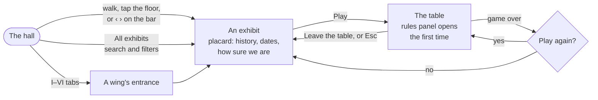
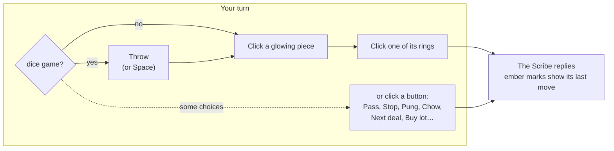

# Visiting the Archives

## Getting around

| | Touch screens | Mouse and keyboard |
| --- | --- | --- |
| **Look** | Drag with one finger | Drag |
| **Walk** | Joystick at bottom left: up and down to walk, left and right to turn. Or tap the floor to walk there | WASD or arrow keys, or click the floor |
| **Zoom** | Pinch, in the hall and at the tables | Scroll wheel or trackpad pinch (Ctrl + scroll when embedded in a page) |
| **At a zoomed-in table** | Drag with one or two fingers to pan | Drag to pan |
| **Visit an exhibit** | Tap it, or use the bar at the bottom | Click it, or use the bar at the bottom |
| **Jump to a wing** | Tap I to VI on the bar | Click I to VI on the bar |
| **Step through exhibits** | ‹ and › on the bar | ‹ and ›, or **[** and **]** |
| **Find any exhibit** | All exhibits (the grid button) | All exhibits: type to search, Enter goes to the first match, Esc closes |

- **The bar along the bottom** shows the wing you are in: its tabs (I to VI) take you to each wing's entrance, the strip lists that wing's exhibits in date order (a gold triangle marks a table you can play, a green dot one you have visited), and it follows you as you walk. **All exhibits** opens an index of every exhibit, grouped by wing, with a search box and filters for playable tables and exhibits you have not visited yet. On a phone the bar takes two rows.
- The joystick appears on touch screens (and as soon as anyone touches the screen on a touch laptop). On a phone it hides while an exhibit card is open, so close the card to walk; walking up to an exhibit lights it on the timeline rather than covering the view, and a tap opens it.
- Zoom eases back to normal when you travel to another exhibit or leave a table.

## At a table

- **Race games** (Senet, Ur, the Goose, Snakes and Ladders, Ludo, Pachisi, Yut Nori, the Landlord's Game): throw, then click a glowing piece. When a throw leaves only one move, it is played for you. In Tables each die is a separate move.
- **Board games:** click a glowing piece, then one of its rings. Where pieces are placed (Go, Hex, Gomoku, Morris placement) or pits are sown (Oware, Kalah, Bao), click the ring or pit directly.
- **Card and tile games:** click a card or tile in your hand; claims and other choices appear as buttons above the message bar.
- **Keyboard:** the arrow keys step through the pieces (or cards) you can move, in reading order on screen; Enter picks one, the arrow keys then step through the rings it can go to, and Enter plays the move. A screen reader announces where you are ("Piece 3 of 12", or the card's name).
- **Esc** clears a selection, or leaves the table.
- **Rules** reopens the *How to play* panel, which ends with a note on where the rules come from.

## Table options

| Option | Where | Choices |
| --- | --- | --- |
| The Scribe's level | every table | Gentle · Fair (default) · Sharp |
| Opponent | two-player tables with nothing hidden (the chess family, Go, draughts, mancala, tafl and the rest) | The Scribe · A friend (pass-and-play on one screen; the Scribe's level is hidden and the game is not added to your record) |
| Board size | Dots and Boxes | 4 × 4 · 5 × 5 |
| | Hex | 7 × 7 · 9 × 9 · 11 × 11 |
| Game length | Pachisi | short (two pieces each) · full (four) |
| | The Landlord's Game | three rounds · five (as in the patent) |
| | Cribbage | to 61 · to 121 |
| Seeds | Kalah | 3 · 4 · 6 a pit |

Choosing a variant or an opponent restarts the game, and every choice is remembered.

## Saved games

Long games against the Scribe are kept as you play: the chess family (chess, shatranj, chaturanga, medieval chess, Courier chess, xiangqi, janggi, makruk), draughts, Tablut, Halma, Reversi, Rithmomachia, Whist and Piquet. The game is saved at the start of each of your turns (at the card tables, between tricks). Leave the table, or close the page, and the game is back on the table as you left it when you sit down again; a **New game** button above the board starts afresh. A finished game clears its save. Pieces already taken are not laid out again beside the board, but the score keeps them.

## Sound

Every sound is made on the spot in the browser: sticks, dice, pieces, Go stones, cards, and a low room tone with the odd candle crackle. Nothing plays until your first click, tap or key; the speaker button (top right) mutes everything and is remembered, and sound pauses while the tab is hidden.

## Your progress

Kept in your browser only: the exhibits you have visited (a green dot on the bar), the Scribe's level, your variant and opponent choices, which rules panels you have seen, any saved games, and your win, loss and draw record at each table, shown on the placard and after each game. Nothing is sent anywhere. If your browser blocks storage, everything still works for that visit.
