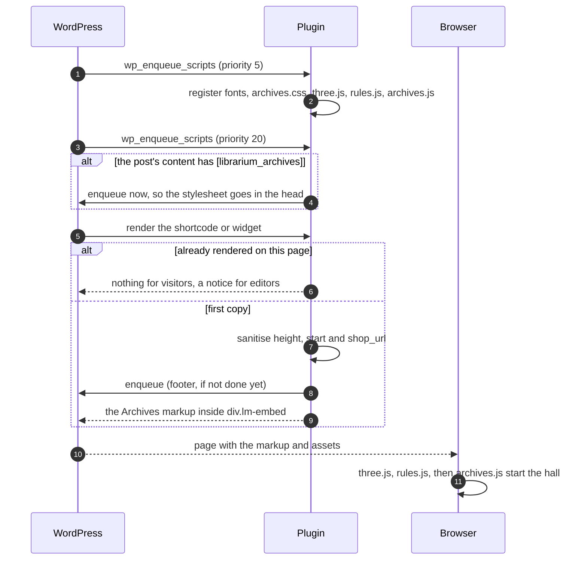
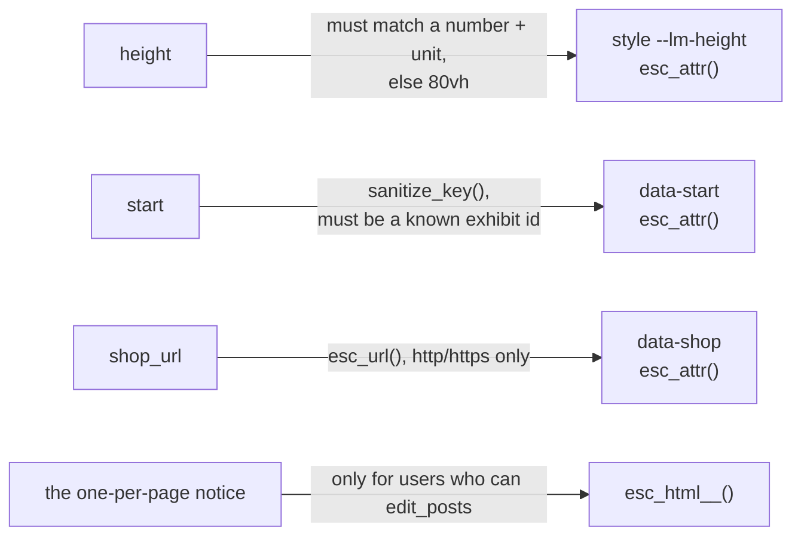

# WordPress plugin

The Archives ship as a WordPress plugin for librarium.games, with a shortcode and an Elementor widget. The plugin's version follows `package.json`: `tools/build-wp.mjs` writes it into the plugin header, the version constant and the readme's stable tag.

## Install

1. Open the latest successful **CI** run on GitHub (Actions tab) and download the `librarium-archives-plugin` artifact.
2. Unzip it to get `librarium-archives.zip`, and upload that under **Plugins › Add New › Upload Plugin**.
3. Activate it, then add the Archives to a page with the shortcode or the **Librarium Archives** widget in Elementor.

```text
[librarium_archives]
[librarium_archives height="720px" start="tables" shop_url="https://librarium.games/"]
```

| Attribute | What it does | Accepted values | Default |
| --- | --- | --- | --- |
| `height` | Height of the Archives box | a number with `px`, `vh`, `svh`, `dvh`, `em`, `rem` or `%` | `80vh` |
| `start` | Exhibit to open on | any [exhibit id](#exhibit-ids) | the entrance |
| `shop_url` | Where the "Visit Librarium Games" button at the end of the hall points | an `http` or `https` URL | `https://librarium.games/` |

The Elementor widget offers the same three settings: a height slider, a dropdown of exhibits, and a link field.

## How a page loads it



## How it behaves on a page

| Behaviour | Detail |
| --- | --- |
| **Embedded, not full-page** | The Archives sit in their own box and scroll with the page. A full-screen button (top right) expands them where the browser allows |
| **Keyboard** | WASD and the arrow keys are taken only while the pointer is over the Archives or focus is inside them, so the page keeps scrolling normally |
| **Scoped styles** | Every rule is scoped under `#lm-app` and every id is prefixed `lm-`, so the theme and the Archives don't restyle each other. The phone layout responds to the box's width (a container query), not the window's |
| **Assets only where needed** | Loaded on pages whose content holds the shortcode (in the head), or when the widget or shortcode renders (in the footer) |
| **Self-contained** | three.js r128 is bundled in the plugin; nothing loads from a CDN except Google Fonts |
| **One per page** | The markup uses fixed ids, so a second copy renders nothing for visitors and a notice for editors |
| **In the Elementor editor** | The widget shows a placeholder; the 3D hall runs on the live page |

`embed-demo.html` imitates a WordPress page with the Archives embedded at 70vh; it is published with the site at `/embed-demo.html`.

## Security

The plugin reads no request data: there is no `$_GET`, `$_POST` or `$_REQUEST`, no form handler, no AJAX or REST endpoint, and no options page. Because nothing is submitted, there is nothing that needs a nonce. Everything the plugin takes in comes from shortcode or widget attributes set by editors, and each one is checked on output.



The CI job lints every PHP file and runs `tests/plugin-render.test.php`, which renders the shortcode with stubbed WordPress functions and checks that hostile attribute values are cleaned. If the plugin ever gains a form, a setting or an AJAX call, each handler must verify a nonce and check the user's capability before WordPress.org submission.

## Exhibit ids

Every exhibit can be a `start` value. ▶ marks a playable table.

| Wing | Exhibits |
| --- | --- |
| I | *(blank: the entrance)* · `senet` ▶ · `mehen` · `basur` · `ur` ▶ · `dice` · `hounds` |
| II | `wing2` · `petteia` · `liubo` · `go` ▶ · `latrunculi` · `patolli` · `morris` ▶ · `oware` ▶ · `alquerque` ▶ · `brandubh` ▶ |
| III | `wing3` · `tables` ▶ · `chaturanga` · `shatranj` ▶ · `xiangqi` ▶ · `chaturaji` ▶ · `lewis` · `fourseasons` ▶ · `cards` · `tarot` ▶ |
| IV | `wing4` · `foxgeese` ▶ · `newqueen` ▶ (chess) · `draughts` ▶ · `pachisi` ▶ · `goose` ▶ · `cribbage` ▶ · `dominoes` ▶ · `tablut` ▶ · `snakes` ▶ · `ludo` ▶ · `mahjong` ▶ |
| V | `wing5` · `mansion` · `lifegame` · `reversi` ▶ · `halma` ▶ · `dotsboxes` ▶ · `chinese` ▶ · `landlord` ▶ · `kalah` ▶ · `hex` ▶ |
| VI | `wing6` · `mutorere` ▶ · `shogi` ▶ · `gomoku` ▶ · `makruk` ▶ · `baghchal` ▶ · `konane` ▶ · `yut` ▶ · `janggi` ▶ · `fanorona` ▶ · `bao` ▶ · `morabaraba` ▶ · `seega` ▶ · `tab` ▶ · `next` (the Librarium lectern) |

The Tarot exhibit's table is the game `tarocchi`, and the New Queen's is `chess`.
